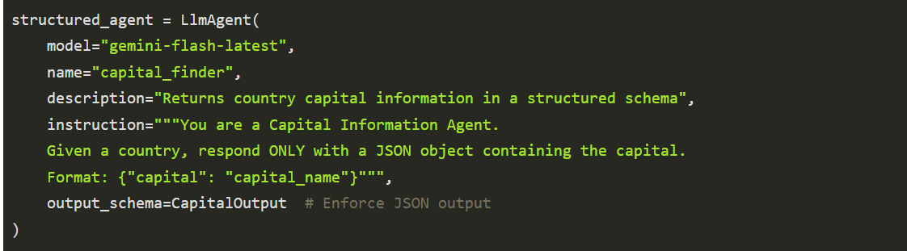
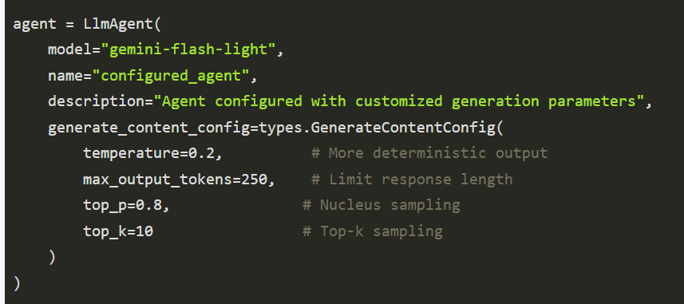

## Pydantic output models

Create a Pydantic model that represents the desired output:

```python
from pydantic import BaseModel, Field

class CapitalOutput(BaseModel):
    capital: str = Field(
        description="The capital of the country"
    )
```


Key points:

- The model must inherit from `BaseModel`.
- Each field has a Python type.
- Use `Field(description="...")` to explain each field to the LLM.
- Pass the class itself to `output_schema`, not an instance:
  `output_schema=CapitalOutput`.

## Create and access a structured agent

Create the agent with `LlmAgent` and assign it to `root_agent`:

```python
from google.adk.agents import LlmAgent

structured_agent = LlmAgent(
    model="gemini-flash-latest",
    name="capital_finder",
    description="Returns country capital information in a structured schema.",
    instruction="""You are a Capital Information Agent.
Given a country, respond ONLY with a JSON object containing the capital.
Format: {"capital": "capital_name"}""",
    output_schema=CapitalOutput,
)

root_agent = structured_agent
```



Access it locally with the ADK web interface:

```powershell
adk web
```

Open `http://localhost:8000`, select the agent, and enter a country name.

## Store the result in session state

Set `output_key` to automatically save the agent's final text response in the
session state dictionary under that key:

```python
structured_agent = LlmAgent(
    model="gemini-flash-latest",
    name="capital_finder",
    description="Returns country capital information in a structured schema.",
    instruction="Return a JSON object containing the country's capital.",
    output_schema=CapitalOutput,
    output_key="capital_result",
)
```


The response is then available from the session state:

```python
capital_result = session.state["capital_result"]
```

When a key is already present, update it in the session state to replace the
previous value:

```python
session.state["capital_result"] = capital_result
```

## Configure generation parameters

Configure an agent's model behavior with `GenerateContentConfig`:

```python
from google.adk.agents import LlmAgent
from google.genai import types

agent = LlmAgent(
    model="gemini-flash-light",
    name="configured_agent",
    description="Agent configured with customized generation parameters",
    generate_content_config=types.GenerateContentConfig(
        temperature=0.2,
        max_output_tokens=250,
        top_p=0.8,
        top_k=10,
    ),
)
```



Common settings:

- `temperature=0.2`: Produces more deterministic, predictable output.
- `max_output_tokens=250`: Limits the maximum response length.
- `top_p=0.8`: Restricts nucleus sampling to the selected probability range.
- `top_k=10`: Restricts sampling to the 10 most likely next tokens.

For structured extraction, keep `temperature` low and combine
`generate_content_config` with `output_schema` and `output_key`:

```python
agent = LlmAgent(
    model="gemini-flash-latest",
    name="product_extractor",
    description="Extracts product information from text",
    output_schema=ProductInfo,
    output_key="extracted_product",
    generate_content_config=types.GenerateContentConfig(
        temperature=0.2,
        max_output_tokens=250,
    ),
)
```

## Add planning to an agent

Use `BuiltInPlanner` to give an agent a token budget for internal reasoning.
The returned thoughts can optionally be included in the agent's result:

```python
from google.adk.agents import LlmAgent
from google.adk.planners import BuiltInPlanner
from google.genai import types

planning_agent = LlmAgent(
    model="gemini-flash-latest",
    name="strategic_decision_agent",
    description="Reasoning agent evaluating multi-variable decisions",
    planner=BuiltInPlanner(
        thinking_config=types.ThinkingConfig(
            include_thoughts=True,  # Include the reasoning process
            thinking_budget=1024,   # Allocate tokens for thinking
        )
    ),
    instruction="Help users make decisions",
)

root_agent = planning_agent
```

Planning configuration:

- `include_thoughts=True` exposes the model's thought summary or process,
  where supported.
- `thinking_budget=1024` limits the number of tokens allocated to internal
  reasoning.
- Set `include_thoughts=False` when only the final response should be shown.
- Increase the budget for complex decisions and lower it for short, simple
  tasks.


### Planning parameters explained

- **`include_thoughts`**: When set to `True`, the response includes the agent's
  internal reasoning process. Thoughts are visible in the developer UI and can
  be captured in telemetry.
- **`thinking_budget`**: Sets the number of tokens the model can use for
  thinking. This budget is separate from the final response text limit, but it
  is factored into overall token usage and quota.