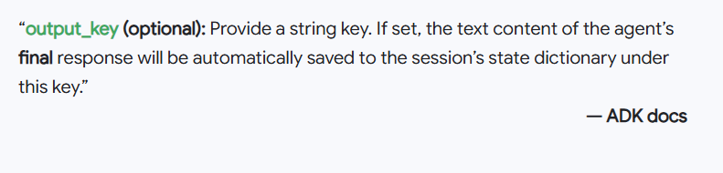

# Google Cloud Run & Agent Development Kit (ADK) Study Notes

A practical reference for developing Google ADK agents locally and deploying
them to Cloud Run. It covers Cloud Run architecture, Google Cloud project
setup, IAM, ADK patterns, Antigravity CLI and MCP configuration, troubleshooting,
deployment, and cleanup.

## 1. Cloud Run and deployment fundamentals

### What is Cloud Run?

- **Fully managed serverless platform:** Runs stateless containers (Docker/OCI
  images) without requiring you to manage servers, virtual machines, or
  Kubernetes clusters.
- **Automatic scaling:** Scales instances in response to traffic. Services
  configured to scale to zero can have no active instances when idle. Minimum
  instances can reduce cold starts but may incur ongoing charges.
- **Cold starts:** When a new instance is needed, starting the container can
  add latency to the first request. Later requests served by that instance
  avoid that startup delay.
- **Ephemeral filesystem:** Files written inside a container are not durable
  storage and are not shared across instances. Use Cloud Storage, Firestore, or
  Cloud SQL for persistent data.
- **No SSH access:** Deploy a new image or revision to change the container;
  packages should be included in the image rather than installed into a live
  instance.
- **Request timeout:** Cloud Run services support request timeouts up to 60
  minutes; choose a timeout suitable for the application.
- **Cost trade-off:** Scale-to-zero can reduce idle compute charges. Services
  with sustained heavy usage may have different cost characteristics than
  VMs; compare current pricing for your workload.

### Cloud Run vs. Compute Engine virtual machines

| Feature | Virtual machine (Compute Engine) | Cloud Run |
| :--- | :--- | :--- |
| **Lifespan** | Usually runs continuously until stopped. | Instances start and stop dynamically based on configuration and demand. |
| **Installing packages** | Install packages on the VM; persistence depends on the disk and setup. | Include packages in the container image, commonly through `requirements.txt` and a build. |
| **Starting the app** | Configure the process, networking, and TLS/reverse proxy as needed. | Provides managed HTTPS ingress and autoscaling for deployed services. |
| **Persistent data** | Attach persistent disks or use external storage. | Container filesystem is ephemeral; use external storage for durable data. |
| **Cleanup** | Delete the VM and any disks or other resources you created. | Delete the service and, if no longer needed, its image repository and images. |

### Approximate AWS equivalents

These are high-level comparisons, not exact equivalents; configuration,
scaling, and billing details differ by service and can change.

| AWS platform | Closest comparison | General distinction |
| :--- | :--- | :--- |
| **AWS App Runner** | Managed application/container hosting, similar in broad use to Cloud Run. | The deployment model and scaling/billing behavior differ; check current AWS pricing and limits. |
| **AWS ECS with Fargate** | Serverless container orchestration. | Offers more orchestration control and can require more setup for clusters, tasks, and load balancing. |
| **AWS Lambda** | Event-driven serverless compute. | Commonly used for functions and event handlers rather than hosting a continuously available web service. |

## 2. Prepare a Google Cloud project

### Set and verify the active project

Set the project ID for your lab or deployment. Replace the example with your
own project ID:

```bash
gcloud config set project YOUR_PROJECT_ID

# Verify the active project
gcloud config get-value project
```

For the Bash commands below, set reusable project and region variables in
Cloud Shell. Replace the region with the one required for your deployment:

```bash
export PROJECT_ID="$(gcloud config get-value project)"
export REGION="us-central1"
```

### Enable APIs

Enable the APIs needed by your deployment. `compute.googleapis.com` may be
needed for some networking or lab setups, but is not required for every
Cloud Run deployment.

```bash
gcloud services enable \
    run.googleapis.com \
    artifactregistry.googleapis.com \
    cloudbuild.googleapis.com \
    aiplatform.googleapis.com \
    compute.googleapis.com
```

- `run.googleapis.com`: Deploy and manage Cloud Run services.
- `artifactregistry.googleapis.com`: Store container images.
- `cloudbuild.googleapis.com`: Build container images from source.
- `aiplatform.googleapis.com`: Access Vertex AI models, including Gemini.
- `compute.googleapis.com`: Compute Engine and some underlying networking
  resources.

If you only need to enable the Vertex AI API for an ADK app, use:

```bash
gcloud services enable aiplatform.googleapis.com --project="$PROJECT_ID"
```

### Check organization model restrictions

Some Qwiklabs or enterprise projects use organization policies to restrict
which Vertex AI foundation models can be called. Enabling the Vertex AI API
does not override an organization policy. A request for a disallowed model
will fail; use an allowed model or ask the organization administrator about
the restriction.

To inspect an effective model allowlist, when this constraint is configured:

```bash
gcloud resource-manager org-policies describe vertexai.allowedModels \
  --effective \
  --project="$PROJECT_ID"
```

For example, a lab may block a model such as `gemini-4-carbon`. Check the
effective policy and the model IDs available to your project rather than
assuming every model name is enabled.

### Install packages in Cloud Shell for local testing

This installs dependencies in your Cloud Shell user environment so you can run
commands such as `adk run` and `adk web`:

```bash
export PATH="$PATH:$HOME/.local/bin"
pip3 install -r requirements.txt --user
```

Cloud Run does not copy Cloud Shell's `~/.local` directory. Dependencies for
the deployed app must be declared in its project files and installed during
the container build.

### Edit files in Cloud Shell

```bash
cloudshell edit requirements.txt
cloudshell edit .env
```

### Project ID vs. project number

- **Project ID:** An alphanumeric identifier, such as
  `qwiklabs-gcp-example-123456`.
- **Project number:** A numeric identifier used in some resource names and
  default service-account email addresses.

Retrieve the numeric project number for the active project:

```bash
gcloud projects describe "$(gcloud config get-value project)" \
  --format="value(projectNumber)"
```

## 3. Create and run an ADK project locally

### Install the ADK dependency

```bash
pip install google-adk
```

`google-adk` installs the ADK classes and compatible dependencies, including
`google-genai` and `pydantic`.

### Create a project on Windows

```powershell
mkdir adk-projects
cd adk-projects

python -m venv .venv
.venv\Scripts\Activate.ps1

pip install google-adk
adk create my_agent
cd my_agent
```

The generated project has this general structure:

```text
my_agent/
  agent.py       # Agent code and the root_agent definition
  .env           # Local API key or Google Cloud configuration
  __init__.py
```

ADK uses the Python package to discover the agent. The `__init__.py` commonly
imports `agent.py`:

```python
from . import agent
```

### Configure local credentials

For local development with an API key, add it to `.env`:

```text
GOOGLE_API_KEY=your-api-key
```

Do not commit real API keys to source control.

### Define a basic agent

Replace the generated `agent.py` with a minimal agent:

```python
from google.adk.agents import Agent

root_agent = Agent(
    name="my_agent",
    model="gemini-flash-latest",
    description="A helpful example agent.",
    instruction="Answer the user's questions clearly and briefly.",
)
```

`root_agent` is the entry point ADK loads for this project.

### Test with the ADK web interface

From the directory containing the agent folder, start the development UI:

```powershell
cd ..
adk web
```

Open `http://localhost:8000`, select `my_agent`, and send a message. ADK Web is
for development and debugging; use a production deployment for live services.

### Test in the terminal

From the directory containing the agent folder:

```powershell
cd C:\path\to\adk-projects
.venv\Scripts\Activate.ps1
adk run my_agent
```

This starts an interactive terminal session. Type a message and press Enter.
Type `exit` or press `Ctrl+C` to stop.

To send one prompt and exit:

```powershell
adk run my_agent "What can you help me with?"
```

The local session data is stored in the project's `.adk` directory by default.
Useful options include:

```powershell
# Start with initial state
adk run --state '{"user:display_name":"Alex"}' my_agent

# Save a session to a JSON file
adk run --save_session my_agent

# Display all available options
adk run --help
```

## 4. ADK agent patterns

### Return structured output with Pydantic

Create a Pydantic model that represents the desired output:

```python
from pydantic import BaseModel, Field


class CapitalOutput(BaseModel):
    capital: str = Field(
        description="The capital of the country"
    )
```


Key points:

- The model must inherit from `BaseModel`.
- Each field has a Python type.
- Use `Field(description="...")` to explain each field to the LLM.
- Pass the class itself to `output_schema`, not an instance:
  `output_schema=CapitalOutput`.

Create the agent with `LlmAgent` and assign it to `root_agent`:

```python
from google.adk.agents import LlmAgent

structured_agent = LlmAgent(
    model="gemini-flash-latest",
    name="capital_finder",
    description="Returns country capital information in a structured schema.",
    instruction="""You are a Capital Information Agent.
Given a country, respond ONLY with a JSON object containing the capital.
Format: {"capital": "capital_name"}""",
    output_schema=CapitalOutput,
)

root_agent = structured_agent
```


### Use session state in an instruction

Agent instructions can read session state through `{key}` placeholders. Use
`{key?default}` to provide fallback text when the key is missing or empty:

```python
root_agent = LlmAgent(
    model="gemini-flash-latest",
    name="personalized_greeter",
    instruction="""
    You are a friendly assistant.

    User information:
    - Name: {user_name?there}
    - Preferred language: {user_language?English}
    - Membership: {membership_tier?free}

    {membership_tier?Your membership level is: {membership_tier}}

    Greet the user warmly and offer assistance.
    Respond in {user_language?English}.
    """
)
```

For example, if the session state contains:

```python
session.state["user_name"] = "Alex"
session.state["user_language"] = "Spanish"
session.state["membership_tier"] = "premium"
```

the instruction receives those values. Missing values use the defaults:
`there`, `English`, and `free`.

- `{key}` inserts a required state value.
- `{key?default}` inserts the default when the state key is missing or empty.
- A state-dependent block such as
  `{membership_tier?Your membership level is: {membership_tier}}` includes
  that text only when `membership_tier` is available.

### Save an agent response with `output_key`

Set `output_key` to save the agent's final response in session state:

```python
structured_agent = LlmAgent(
    model="gemini-flash-latest",
    name="capital_finder",
    description="Returns country capital information in a structured schema.",
    instruction="Return a JSON object containing the country's capital.",
    output_schema=CapitalOutput,
    output_key="capital_result",
)
```



Read or update the saved value through the session state:

```python
capital_result = session.state["capital_result"]
session.state["capital_result"] = capital_result
```

### Run a sequence of agents

Use `SequentialAgent` when a task has separate steps that should always run in
a fixed order. The first agent below extracts action items and saves them to
session state; the second agent formats them:

```python
from google.adk.agents import LlmAgent, SequentialAgent

extractor = LlmAgent(
    model="gemini-flash-latest",
    name="action_item_extractor",
    instruction=(
        "Extract the action items from the user's message. "
        "Return only the action items as a concise list."
    ),
    output_key="action_items",
)

formatter = LlmAgent(
    model="gemini-flash-latest",
    name="action_item_formatter",
    instruction=(
        "Format these action items as a clear checklist:\n"
        "{action_items}"
    ),
)

root_agent = SequentialAgent(
    name="action_item_workflow",
    description="Extracts action items, then formats them as a checklist.",
    sub_agents=[extractor, formatter],
)
```

The agents run in the order listed in `sub_agents`. The first agent's
`output_key` makes its result available to the next agent through session
state.

#### How this differs from a single agent

In the earlier pattern, one `LlmAgent` is assigned directly to `root_agent`,
such as `root_agent = structured_agent`. That agent handles the request from
start to finish.

Here, `root_agent` is a `SequentialAgent`, which coordinates the child agents.
The extractor handles the first step, then the formatter handles the next.
`output_key` passes the extractor's result through session state, and
`{action_items}` lets the formatter use that result.

This is an extension of the earlier approach, not a completely different
agent model: both patterns use `LlmAgent`. Use a single agent for a
straightforward task; use a sequential workflow when distinct steps benefit
from separate agents and a fixed order.

### Configure generation parameters

Use `GenerateContentConfig` to customize model generation:

```python
from google.adk.agents import LlmAgent
from google.genai import types

agent = LlmAgent(
    model="gemini-flash-light",
    name="configured_agent",
    description="Agent configured with customized generation parameters",
    generate_content_config=types.GenerateContentConfig(
        temperature=0.2,
        max_output_tokens=250,
        top_p=0.8,
        top_k=10,
    ),
)
```


Common settings:

- `temperature=0.2`: Lower temperatures generally make output more
  predictable.
- `max_output_tokens=250`: Limits the maximum response length.
- `top_p=0.8`: Restricts nucleus sampling to the selected probability range.
- `top_k=10`: Restricts sampling to the 10 most likely next tokens.

For structured extraction, combine `generate_content_config` with
`output_schema` and `output_key`:

```python
agent = LlmAgent(
    model="gemini-flash-latest",
    name="product_extractor",
    description="Extracts product information from text",
    output_schema=ProductInfo,
    output_key="extracted_product",
    generate_content_config=types.GenerateContentConfig(
        temperature=0.2,
        max_output_tokens=250,
    ),
)
```

### Add planning to an agent

Use `BuiltInPlanner` to configure a model's thinking budget. Thought summaries
can optionally be included in results where supported:

```python
from google.adk.agents import LlmAgent
from google.adk.planners import BuiltInPlanner
from google.genai import types

planning_agent = LlmAgent(
    model="gemini-flash-latest",
    name="strategic_decision_agent",
    description="Reasoning agent evaluating multi-variable decisions",
    planner=BuiltInPlanner(
        thinking_config=types.ThinkingConfig(
            include_thoughts=True,
            thinking_budget=1024,
        )
    ),
    instruction="Help users make decisions",
)

root_agent = planning_agent
```

- `include_thoughts=True` includes supported thought summaries in the result.
  Avoid treating these summaries as a complete or guaranteed reasoning trace.
- `thinking_budget=1024` sets the token budget for thinking, subject to model
  support and limits.
- Set `include_thoughts=False` when only the final response should be shown.
- Increase the budget for complex tasks and lower it for simple tasks.


### Save a result and make an application decision

`output_key` saves an agent's final response in session state. This example
uses the asynchronous session and runner APIs:

```python
import asyncio

from google.adk.agents import LlmAgent
from google.adk.runners import Runner
from google.adk.sessions import InMemorySessionService
from google.genai import types


async def main() -> None:
    agent = LlmAgent(
        name="name_extractor",
        model="gemini-flash-latest",
        instruction="Extract the user's name. Return ONLY the name.",
        output_key="user_name",
    )

    session_service = InMemorySessionService()
    session = await session_service.create_session(
        app_name="my_app",
        user_id="user1",
    )
    runner = Runner(
        agent=agent,
        app_name="my_app",
        session_service=session_service,
    )

    message = types.Content(
        role="user",
        parts=[types.Part(text="My name is Alex")],
    )
    async for event in runner.run_async(
        user_id="user1",
        session_id=session.id,
        new_message=message,
    ):
        if event.is_final_response() and event.content:
            print(event.content.parts[0].text)

    # output_key stores the final response in the session state.
    print(session.state)
    print(session.state.get("user_name"))

    if session.state.get("user_name"):
        print("User has provided their name!")


if __name__ == "__main__":
    asyncio.run(main())
```

The application can inspect a saved classification and choose what to do next:

```python
support_agent = LlmAgent(
    name="support_classifier",
    model="gemini-flash-latest",
    instruction=(
        "Classify the request as urgent, resolved, or needs_review. "
        "Return exactly one of those three words."
    ),
    output_key="classification",
)

# Run the agent, then inspect the value saved by output_key.
result = (session.state.get("classification") or "").strip().lower()

if result == "urgent":
    print("Escalate the request to the on-call team.")
elif result == "resolved":
    print("Close the request and send a confirmation.")
elif result == "needs_review":
    print("Route the request to a support specialist.")
else:
    print("The classification is missing or invalid; ask for human review.")
```

This pattern keeps the model responsible for producing a result and the
application responsible for deciding what to do with it.

`InMemorySessionService` is suitable for local development and testing. For
state that must survive process restarts, use a database-backed session
service.

For a local run using an API key, set it in PowerShell before starting the
script:

```powershell
$env:GOOGLE_API_KEY = "your-api-key"
python state_demo.py
```

### Use LLM handoff and sub-agents

An LLM agent can use its instructions and tools to decide when to hand control
to a sub-agent. This differs from `SequentialAgent`: a sequential workflow
runs its children in a code-defined order, while an LLM agent can choose a
handoff based on the conversation.

The example assumes `model_name`, `add_prompt_to_state`, and
`tour_guide_workflow` are defined elsewhere:

```python
from google.adk.agents import Agent

root_agent = Agent(
    name="greeter",
    model=model_name,
    description="The main entry point for the Zoo Tour Guide.",
    instruction="""Let the user know you will help them learn about the animals
    in the zoo. When the user responds, use the 'add_prompt_to_state' tool to
    save their response. After using the tool, transfer control to the
    'tour_guide_workflow' agent.""",
    tools=[add_prompt_to_state],
    sub_agents=[tour_guide_workflow],
)
```

Adding `tour_guide_workflow` as a sub-agent makes handoff available to the
parent agent. The instruction guides the model to save the user's response
first and then transfer control to the workflow.

### Token streaming (SSE)

Enabling token streaming in the ADK Web UI uses Server-Sent Events (SSE)
streaming mode to display generated response text incrementally rather than
waiting for the full response.

## 5. Prepare Cloud Run identity and permissions

### How Cloud Run authentication differs from local development

Locally, an agent may use your API key or your authenticated developer
credentials. A deployed Cloud Run service runs as an attached service account.
That service account must have the permissions the application needs, such as
calling Vertex AI.

Setting an environment variable containing a service-account email does not
attach that identity to a Cloud Run service. Select the service account during
deployment or configure it on the Cloud Run service.

Example environment values from a Vertex AI-based lab (use the values and
model required by your own lab):

```env
MODEL="gemini-3.8-flash"
SERVICE_ACCOUNT="<PROJECT_NUMBER>-compute@developer.gserviceaccount.com"
GOOGLE_GENAI_USE_ENTERPRISE=true
GOOGLE_CLOUD_LOCATION=global
```

### Verify Vertex AI permission

The Cloud Run service account generally needs `roles/aiplatform.user` to call
Vertex AI. Set `PROJECT_ID` and `SERVICE_ACCOUNT` to the appropriate values:

```bash
gcloud projects get-iam-policy "$PROJECT_ID" \
  --flatten="bindings[].members" \
  --format="table(bindings.role)" \
  --filter="bindings.members:serviceAccount:$SERVICE_ACCOUNT AND bindings.role:roles/aiplatform.user"
```

### Understand the Cloud Run Invoker role

`roles/run.invoker` controls who can call a Cloud Run service. It is not the
role that lets the service account call Vertex AI. For a service intended to
be publicly accessible, a project may grant the role to `allUsers`:

```bash
gcloud run services add-iam-policy-binding zoo-tour-guide \
  --region="$REGION" \
  --member="allUsers" \
  --role="roles/run.invoker"
```

Public access may be restricted by organization policy. Grant public access
only when it is appropriate for the application.

To inspect project-level invoker bindings for a service account:

```bash
gcloud projects get-iam-policy "$PROJECT_ID" \
  --flatten="bindings[].members" \
  --format="table(bindings.role)" \
  --filter="bindings.members:serviceAccount:$SERVICE_ACCOUNT AND bindings.role:roles/run.invoker"
```

## 6. Deploy and manage the ADK agent

### Deploy to Cloud Run

From the agent project directory, ADK can generate the container deployment,
build and push the image, and deploy the service:

```bash
adk deploy cloud_run \
  --project="$PROJECT_ID" \
  --region="$REGION" \
  --service_name=zoo-tour-guide \
  --with_ui \
  .
```

Configure the Cloud Run service to run as the intended service account as part
of deployment or service configuration, and ensure it has the necessary IAM
permissions.

For an existing service, attach the service account with:

```bash
gcloud run services update zoo-tour-guide \
  --region="$REGION" \
  --service-account="$SERVICE_ACCOUNT"
```

### Update service labels and environment variables

```bash
gcloud run services update zoo-tour-guide \
  --region="$REGION" \
  --update-labels=dev-tutorial=codelab-adk \
  --set-env-vars="MODEL=$MODEL,MCP_SERVER_URL=$MCP_SERVER_URL,GOOGLE_CLOUD_LOCATION=global"
```

### List services and image repositories

```bash
# List all Cloud Run services
gcloud run services list

# List services in a specific region
gcloud run services list --region="$REGION"

# List Artifact Registry repositories
gcloud artifacts repositories list
```

## 7. Operate and troubleshoot deployed agents

### Select a model in the Antigravity CLI (`agy`)

List the model IDs supported by the installed CLI, then use an available ID
when starting a session:

```bash
agy models
agy --model gemini-3.8-flash-low
```

In an active `agy` session, use `/model` to select a different model. The CLI
may let you save the selection as its new default.

### Configure an MCP server

The Gemini CLI MCP configuration can connect to a remote HTTP/SSE tool server,
such as an MCP service hosted on Cloud Run. A typical configuration is stored
under `~/.gemini/` (for example, `~/.gemini/config/mcp_config.json`):

```json
{
  "mcpServers": {
    "zoo-remote": {
      "serverUrl": "https://<CLOUD_RUN_URL>/mcp/",
      "headers": {
        "Authorization": "Bearer <CURRENT_ID_TOKEN>"
      }
    }
  }
}
```

Replace the placeholders with your service URL and a current identity token.
Do not assume that a literal `$ID_TOKEN` in JSON will be expanded as an
environment variable unless the CLI's configuration format explicitly
supports it. Avoid committing tokens or storing them in shared files.

Create a token with:

```bash
gcloud auth print-identity-token
```

Identity tokens are short-lived (typically about one hour), so refresh the
token when authentication expires during a long session. The account used to
create the token must be allowed to invoke the Cloud Run service.

### Review MCP tool permission rules

The CLI can remember tool approvals or denials in its user settings. If a
server tool is unexpectedly blocked, inspect the matching MCP permissions:

```bash
grep -rn "zoo-remote" ~/.gemini/
```

You can review or change permissions with the CLI's `/permissions` command.
Avoid automatically approving all tools on a machine with valuable
credentials. The `--yolo` option bypasses approval prompts, so use it only in
a disposable, trusted sandbox with an MCP server you control:

```bash
agy --model gemini-3.8-flash-low --yolo
```

### Troubleshoot a blank ADK Dev UI

If `/dev-ui/` loads its HTML title but the page stays blank, check the browser
developer console and network panel for failed or incomplete JavaScript
bundles, then inspect Cloud Run logs:

```bash
gcloud run services logs read <SERVICE_NAME> \
  --region="$REGION" \
  --limit=50
```

An HTTP `206 Partial Content` response is not necessarily an error by itself.
If a large Angular bundle remains incomplete or repeatedly stalls, test without
privacy shields or ad blockers, or use an Incognito Chrome window and hard
refresh (`Ctrl+Shift+R`). You can also test end-to-end HTTP/2 for the service:

```bash
gcloud run services update <SERVICE_NAME> \
  --region="$REGION" \
  --use-http2
```

HTTP/2 is a troubleshooting option, not a guaranteed fix; verify the browser's
network requests after changing the service.

### Test an ADK service through its REST API

When the web UI is unavailable, you can create a session and send a prompt
directly to the ADK service. Replace `<SERVICE_URL>` with the deployed service
URL. These example endpoints assume the ADK app is named `zoo_guide_agent`.

Create a user session:

```bash
curl -X POST "<SERVICE_URL>/apps/zoo_guide_agent/users/user/sessions/session1" \
  -H "Content-Type: application/json" \
  -d '{}'
```

Send a prompt to `/run`:

```bash
curl -X POST "<SERVICE_URL>/run" \
  -H "Content-Type: application/json" \
  -d '{
    "appName": "zoo_guide_agent",
    "userId": "user",
    "sessionId": "session1",
    "newMessage": {
      "role": "user",
      "parts": [{"text": "Where can I find elephants?"}]
    }
  }'
```

For a private Cloud Run service, authenticate both requests by adding this
header:

```bash
-H "Authorization: Bearer $(gcloud auth print-identity-token)"
```

The response contains the agent's event data; inspect the returned events for
the final response text.

## 8. Clean up deployed resources

Delete the Cloud Run service when it is no longer needed. Delete the image
repository only if you no longer need its images or other services that use it.

```bash
gcloud run services delete zoo-tour-guide \
  --region="$REGION" \
  --quiet

gcloud artifacts repositories delete cloud-run-source-deploy \
  --location="$REGION" \
  --quiet
```

## 9. How Skills Boost (Qwiklabs) grades labs

- **Checks live project state:** “Check my progress” queries Google Cloud
  resources and settings; it does not simply inspect terminal command history.
- **Exact parameters matter:** Resource names, regions, labels, and IAM
  bindings may need to match the lab instructions exactly.
