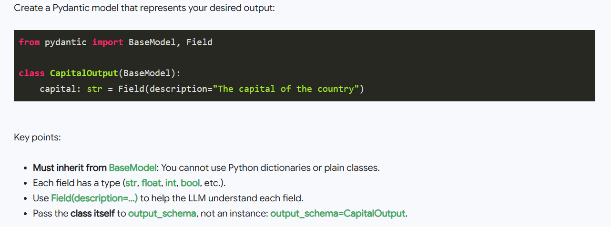
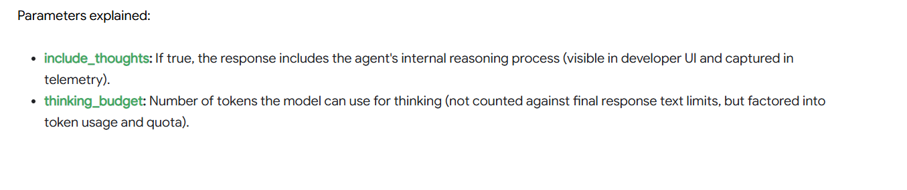

## Pydantic output models

Create a Pydantic model that represents the desired output:

```python
from pydantic import BaseModel, Field

class CapitalOutput(BaseModel):
    capital: str = Field(
        description="The capital of the country"
    )
```



Key points:

- The model must inherit from `BaseModel`.
- Each field has a Python type.
- Use `Field(description="...")` to explain each field to the LLM.
- Pass the class itself to `output_schema`, not an instance:
  `output_schema=CapitalOutput`.

## Create and access a structured agent

Create the agent with `LlmAgent` and assign it to `root_agent`:

```python
from google.adk.agents import LlmAgent

structured_agent = LlmAgent(
    model="gemini-flash-latest",
    name="capital_finder",
    description="Returns country capital information in a structured schema.",
    instruction="""You are a Capital Information Agent.
Given a country, respond ONLY with a JSON object containing the capital.
Format: {"capital": "capital_name"}""",
    output_schema=CapitalOutput,
)

root_agent = structured_agent
```


Access it locally with the ADK web interface:

```powershell
adk web
```

Open `http://localhost:8000`, select the agent, and enter a country name.

## Store the result in session state

Set `output_key` to automatically save the agent's final text response in the
session state dictionary under that key:

```python
structured_agent = LlmAgent(
    model="gemini-flash-latest",
    name="capital_finder",
    description="Returns country capital information in a structured schema.",
    instruction="Return a JSON object containing the country's capital.",
    output_schema=CapitalOutput,
    output_key="capital_result",
)
```


The response is then available from the session state:

```python
capital_result = session.state["capital_result"]
```

When a key is already present, update it in the session state to replace the
previous value:

```python
session.state["capital_result"] = capital_result
```

## Use state values in an instruction with `{key}`

Agent instructions can read session state directly with `{key}` placeholders.
Use `{key?default}` to provide fallback text when the key is missing:

```python
root_agent = LlmAgent(
    model="gemini-flash-latest",
    name="personalized_greeter",
    instruction="""
    You are a friendly assistant.

    User information:
    - Name: {user_name?there}
    - Preferred language: {user_language?English}
    - Membership: {membership_tier?free}

    {membership_tier?Your membership level is: {membership_tier}}

    Greet the user warmly and offer assistance.
    Respond in {user_language?English}.
    """
)
```

For example, if the session state contains:

```python
session.state["user_name"] = "Alex"
session.state["user_language"] = "Spanish"
session.state["membership_tier"] = "premium"
```

the instruction receives the user's name, language, and membership level.
Missing values use the defaults: `there`, `English`, and `free`.

- `{key}` inserts a required state value.
- `{key?default}` inserts `default` when the state key is missing or empty.
- Put state-dependent text in a block with
  `{membership_tier?Your membership level is: {membership_tier}}` to include
  that text only when `membership_tier` is available.

## Configure generation parameters

Configure an agent's model behavior with `GenerateContentConfig`:

```python
from google.adk.agents import LlmAgent
from google.genai import types

agent = LlmAgent(
    model="gemini-flash-light",
    name="configured_agent",
    description="Agent configured with customized generation parameters",
    generate_content_config=types.GenerateContentConfig(
        temperature=0.2,
        max_output_tokens=250,
        top_p=0.8,
        top_k=10,
    ),
)
```


Common settings:

- `temperature=0.2`: Produces more deterministic, predictable output.
- `max_output_tokens=250`: Limits the maximum response length.
- `top_p=0.8`: Restricts nucleus sampling to the selected probability range.
- `top_k=10`: Restricts sampling to the 10 most likely next tokens.

For structured extraction, keep `temperature` low and combine
`generate_content_config` with `output_schema` and `output_key`:

```python
agent = LlmAgent(
    model="gemini-flash-latest",
    name="product_extractor",
    description="Extracts product information from text",
    output_schema=ProductInfo,
    output_key="extracted_product",
    generate_content_config=types.GenerateContentConfig(
        temperature=0.2,
        max_output_tokens=250,
    ),
)
```

## Add planning to an agent

Use `BuiltInPlanner` to give an agent a token budget for internal reasoning.
The returned thoughts can optionally be included in the agent's result:

```python
from google.adk.agents import LlmAgent
from google.adk.planners import BuiltInPlanner
from google.genai import types

planning_agent = LlmAgent(
    model="gemini-flash-latest",
    name="strategic_decision_agent",
    description="Reasoning agent evaluating multi-variable decisions",
    planner=BuiltInPlanner(
        thinking_config=types.ThinkingConfig(
            include_thoughts=True,  # Include the reasoning process
            thinking_budget=1024,   # Allocate tokens for thinking
        )
    ),
    instruction="Help users make decisions",
)

root_agent = planning_agent
```

Planning configuration:

- `include_thoughts=True` exposes the model's thought summary or process,
  where supported.
- `thinking_budget=1024` limits the number of tokens allocated to internal
  reasoning.
- Set `include_thoughts=False` when only the final response should be shown.
- Increase the budget for complex decisions and lower it for short, simple
  tasks.



## Use `session.state` with `output_key`

`output_key` saves the agent's final response in the session state. The current
ADK session and runner APIs are asynchronous, so the example uses
`create_session` and `run_async`:

```python
import asyncio

from google.adk.agents import LlmAgent
from google.adk.runners import Runner
from google.adk.sessions import InMemorySessionService
from google.genai import types


async def main() -> None:
    agent = LlmAgent(
        name="name_extractor",
        model="gemini-flash-latest",
        instruction="Extract the user's name. Return ONLY the name.",
        output_key="user_name",
    )

    session_service = InMemorySessionService()
    session = await session_service.create_session(
        app_name="my_app",
        user_id="user1",
    )
    runner = Runner(
        agent=agent,
        app_name="my_app",
        session_service=session_service,
    )

    message = types.Content(
        role="user",
        parts=[types.Part(text="My name is Alex")],
    )
    async for event in runner.run_async(
        user_id="user1",
        session_id=session.id,
        new_message=message,
    ):
        if event.is_final_response() and event.content:
            print(event.content.parts[0].text)

    # output_key stores the final response in the session state.
    print(session.state)
    print(session.state.get("user_name"))

    if session.state.get("user_name"):
        print("User has provided their name!")


if __name__ == "__main__":
    asyncio.run(main())
```

### Example: make a decision from saved state

The agent can classify a support request and save the classification in state.
The application then reads that state and chooses the next action:

```python
support_agent = LlmAgent(
    name="support_classifier",
    model="gemini-flash-latest",
    instruction=(
        "Classify the request as urgent, resolved, or needs_review. "
        "Return exactly one of those three words."
    ),
    output_key="classification",
)

# Run the agent, then inspect the value saved by output_key.
result = (session.state.get("classification") or "").strip().lower()

if result == "urgent":
    print("Escalate the request to the on-call team.")
elif result == "resolved":
    print("Close the request and send a confirmation.")
elif result == "needs_review":
    print("Route the request to a support specialist.")
else:
    print("The classification is missing or invalid; ask for human review.")
```

This pattern keeps the model responsible for producing a result and the
application responsible for deciding what to do with that result.

Install the dependency with:

```powershell
pip install google-adk
```

`google-adk` provides the ADK classes and installs compatible `google-genai`
and `pydantic` dependencies. Set `GOOGLE_API_KEY` before running the example:

```powershell
$env:GOOGLE_API_KEY = "your-api-key"
python state_demo.py
```

`InMemorySessionService` is suitable for local development and testing. For
state that must survive process restarts, use a database-backed session
service.

## Create an ADK project

The following commands create a new Google ADK Python project on Windows:

```powershell
mkdir adk-projects
cd adk-projects

python -m venv .venv
.venv\Scripts\Activate.ps1

pip install google-adk
adk create my_agent
cd my_agent
```

The generated project contains:

```text
my_agent/
  agent.py       # Agent code and the root_agent definition
  .env           # API key or Google Cloud configuration
  __init__.py
```

Put your API key in `.env`:

```text
GOOGLE_API_KEY=your-api-key
```

Replace `agent.py` with a minimal agent:

```python
from google.adk.agents import Agent

root_agent = Agent(
    name="my_agent",
    model="gemini-flash-latest",
    description="A helpful example agent.",
    instruction="Answer the user's questions clearly and briefly.",
)
```

Start the development web interface from the directory containing the agent
folder:

```powershell
cd ..
adk web
```

Open `http://localhost:8000`, select `my_agent`, and send a message. ADK Web is
for development and debugging; use a production deployment for live services.

## Run an agent in the terminal

You do not need ADK Web to test an agent. From the directory that contains the
agent folder, run:

```powershell
cd C:\path\to\adk-projects
.venv\Scripts\Activate.ps1
adk run my_agent
```

This starts an interactive terminal session. Type a message, press Enter, and
type `exit` or press `Ctrl+C` to stop.

To send one prompt and exit:

```powershell
adk run my_agent "What can you help me with?"
```

The agent's local session data is stored in the project's `.adk` directory by
default. Useful options include:

```powershell
# Start with initial state
adk run --state '{"user:display_name":"Alex"}' my_agent

# Save a session to a JSON file
adk run --save_session my_agent

# Display all available options
adk run --help
```

### Planning parameters explained

- **`include_thoughts`**: When set to `True`, the response includes the agent's
  internal reasoning process. Thoughts are visible in the developer UI and can
  be captured in telemetry.
- **`thinking_budget`**: Sets the number of tokens the model can use for
  thinking. This budget is separate from the final response text limit, but it
  is factored into overall token usage and quota.